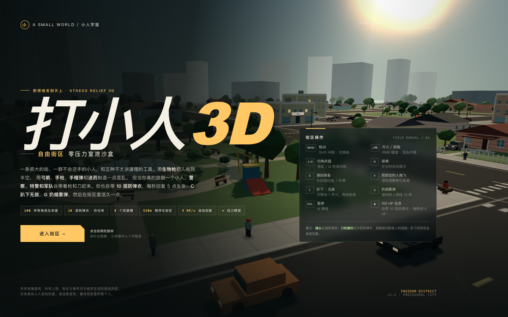
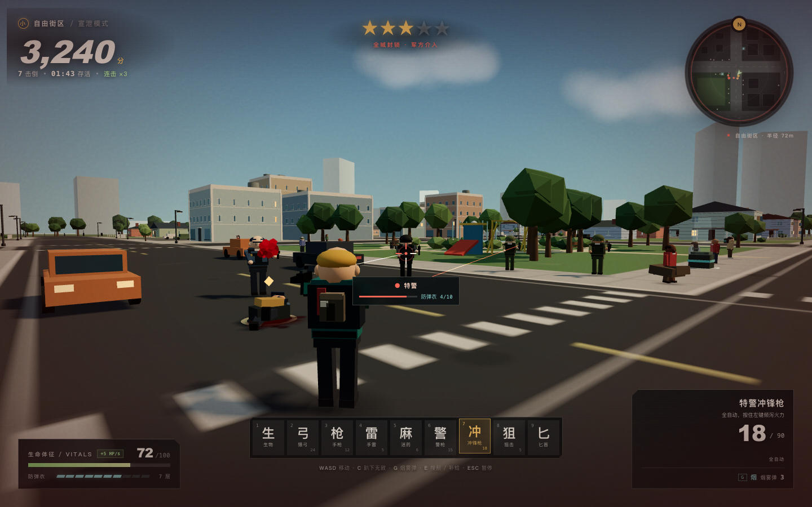
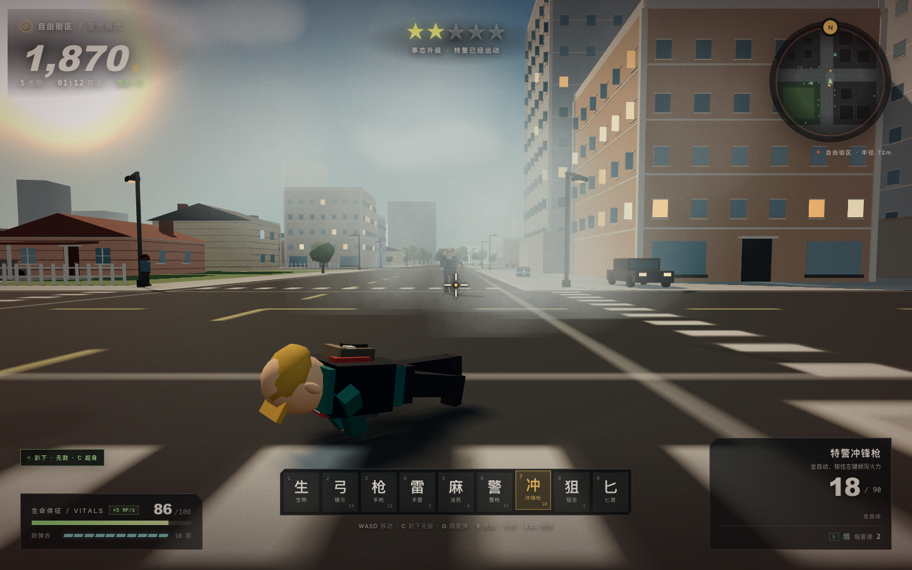

# 打小人 3D · 自由街区

**一个跑在浏览器里的第三人称 3D 解压沙盒。**  
一座 520×520 米的程序化街区，一群不会还手的小人，五种不太讲道理的工具。放倒一个小人，警察、特警和军队就会带着枪和刀来找你。你自带 10 层防弹衣、每秒 5 点生命回复，还能趴下无敌、扔烟雾弹。捡起他们的武器，活久一点。

**单文件 HTML · 无需安装 · 打开即玩 · 所有模型、贴图与音效均由代码实时生成。**

> 推荐桌面浏览器：Chrome / Edge / Safari，并开启硬件加速。需要键盘和鼠标。进入游戏后系统鼠标指针会隐藏，屏幕中心十字就是准星。



## 玩法一句话

> 先用生物枪把烦恼拖到天上，再用你捡来的警用装备和整条街的增援讲讲道理。



- **所有角色都是 100 点生命值**：你、居民、警察、特警、军人。
- **你自带 10 层防弹衣**，躯干中弹会被完整挡下；**每秒自动回复 5 点生命**。
- **按 C 趴下进入无敌状态**：所有伤害免疫，可以慢速爬行、开火和扔道具；再按 C 起身。
- **按 G 扔烟雾弹**：落点展开 12 秒烟幕，警察、特警和狙击手会失去视线，无法开枪锁定你。
- 小人没有武器，也不会攻击你；他们只会逃跑、流血、倒下。
- 一旦有小人被打死，通缉会升级。警察、特警和军方会分波抵达，**只攻击你一个人**。
- 警察、特警、军人都穿着 **10 层防弹衣**。躯干中弹会被完全挡下，10 发后护甲碎裂；**爆头、刀和爆炸无视防弹衣**。
- 走近倒下的武装人员按 **E**，可以捡走剩余防弹衣和武器：警用手枪、特警冲锋枪、军用狙击枪、战术匕首。
- 街区里散落着**补给箱**：回复生命，补充弹药和烟雾弹，有冷却。

## 五种起始武器 + 烟雾弹

| 槽位 | 武器 | 说明 |
| --- | --- | --- |
| 1 | **生物枪** | 左键牵引任何小人，移动鼠标拖到半空或别处；滚轮调整距离；**F 抛飞**；左键松开投放。 |
| 2 | **猎弓** | 按住左键蓄力，松开射出实体箭矢；爆头伤害极高。 |
| 3 | **手枪** | 12 发弹匣，备弹无限；躯干 28 / 爆头 100。 |
| 4 | **手榴弹** | 抛物线投掷，2 秒爆炸；会把自己和尸体一起炸飞。 |
| 5 | **迷药枪** | 麻醉飞镖，命中后目标昏迷约 13 秒；迷药无视防弹衣。 |
| G | **烟雾弹** | 战术道具，不占武器槽。落点展开 12 秒烟幕，切断敌人视线；初始 3 枚，最多 5 枚。 |

## 可以从敌人身上缴获的装备

| 来源 | 装备 |
| --- | --- |
| 警察 | 警用手枪、战术匕首、剩余防弹衣 |
| 特警 | 特警冲锋枪、战术匕首、剩余防弹衣 |
| 军方狙击手 | 军用狙击枪、战术匕首、剩余防弹衣 |
| 军方突击手 | 特警冲锋枪、战术匕首、剩余防弹衣 |

- 狙击枪右键开镜，8 倍瞄准镜，爆头一击必杀。
- 冲锋枪全自动，按住左键倾泻火力。
- 战术匕首完全无视防弹衣。
- 每具武装尸体还会提供少量箭矢、迷药、手雷、烟雾弹和急救回复。

## 敌人与通缉

| 敌人 | 武器 | 特点 |
| --- | --- | --- |
| 警察 | 警用手枪 + 匕首 | 数量多，会走位并靠近 |
| 特警 | 冲锋枪 + 匕首 | 连发压制，近身切换匕首 |
| 军方狙击手 | 狙击枪 + 匕首 | 远距离架枪，开枪前有**红色激光预警** |
| 军方突击手 | 冲锋枪 + 匕首 | 移动灵活，火力更密集 |

通缉从 1 星到 5 星逐级上升：**警察 → 特警 → 军方**。通常第 2 次击杀后特警就会出动，第 4 次击杀后军方介入；增援波次会不断刷新，直到你躲开足够久、通缉降温。躲进建筑后面、打断视线，或者干脆把整波人放倒。

## 世界

- **520 × 520 米**程序化城市，6 × 6 个街区。
- 纵横交错的道路、斑马线、路缘、路灯、人行道、停放车辆和树。
- 大量独栋房屋、带门廊和围栏的前院、城市公寓、屋顶设施、便利店、面馆、药房等。
- 中央公园有喷泉、步道、游乐设施、长椅和树林；另有带池塘和球场的口袋公园。
- 枪弹会被墙体阻挡。警察与军人会利用建筑和街道追逐你。
- 通缉越高，街头的增援越多；尸体和血迹不会马上消失。烟幕可以挡住 AI 的视线。

## 操作

| 操作 | 键鼠 |
| --- | --- |
| 移动 / 冲刺 / 跳跃 | `WASD` / `Shift` / `Space` |
| 趴下无敌 / 起身 | `C` |
| 扔烟雾弹 | `G` |
| 瞄准 / 开镜 | 按住鼠标右键 |
| 开火 / 牵引 / 射箭 | 鼠标左键 |
| 切换武器 | `1` – `9` / 滚轮 / `Q` |
| 装填 | `R` |
| 搜刮 / 打开补给箱 | `E` |
| 抛飞被牵引者 | `F` |
| 暂停 | `Esc` / `P` |
| 静音 | `M` |
| 调整牵引距离 | 滚轮（持有目标时） |

> 游戏会请求鼠标指针锁定。进入游戏后系统鼠标指针会隐藏，屏幕中心的十字就是准星和实际射击方向；若浏览器拒绝锁定，移动鼠标仍可瞄准，点击画面可重试锁定。

## 运行

**最简单的方式：双击 `index.html`。**

也可以启动一个本地服务器：

```bash
python3 -m http.server 8000
# 打开 http://localhost:8000
```

或使用项目自带的小服务器：

```bash
pnpm install
pnpm run serve
# http://127.0.0.1:8123
```

## 构建

源码在 `src/`，使用 Three.js + esbuild 打包成单文件：

```bash
pnpm install
pnpm run build
```

`build.js` 会把 `src/main.js` 及其依赖内联进 `index.html`，生成可以直接分享的单文件游戏。

## 项目结构

```text
index.html          构建后的单文件游戏
src/
  main.js           游戏循环、玩家控制、武器、波次、掉落
  world.js          程序化城市、碰撞、导航流场、小地图
  human.js          角色模型、动画、血量/护甲、流血与布娃娃
  ai.js             居民逃跑 AI、警察/特警/军方战斗 AI
  weapons.js        武器数值与第一/第三人称简易枪模
  effects.js        血液、弹道、枪口火光、爆炸、血迹
  audio.js          WebAudio 实时合成音效
  ui.js             HUD、菜单、小地图、战斗飘字
  index.html        HTML/CSS 模板与 UI 结构
build.js            打包内联脚本
server.js           本地静态服务器
preview.png         开始界面截图
preview-game.png    实际战斗截图
preview-prone.png   趴下无敌与烟幕效果截图
```

## 1.1 更新



- 玩家自带 10 层防弹衣。
- 生命每秒回复 5 点。
- `C` 趴下无敌（可移动、开火）。
- `G` 烟雾弹，烟幕会切断警察/特警/狙击手的视线。
- 初始自带 10 层防弹衣，生命每秒回复 5 点。
- 隐藏系统鼠标指针，解决准星与鼠标指针错位；中心十字即射击方向。

## 说明

- 本作纯属虚构，所有人物、街区与事件均为程序生成的游戏内容。
- 游戏中的图片、音效、模型均由代码实时生成，不包含外部素材。
- 没有真实小人受到伤害。请适度宣泄，善待现实里的每个人。
